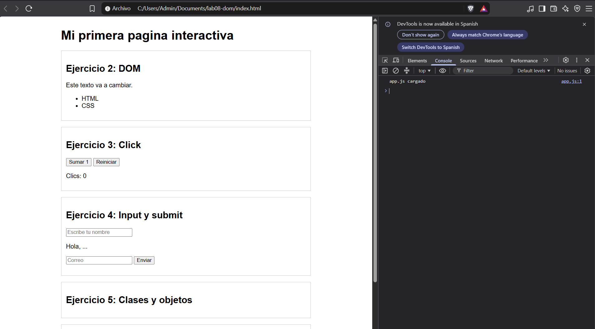
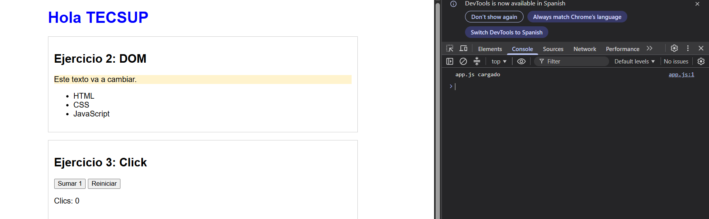
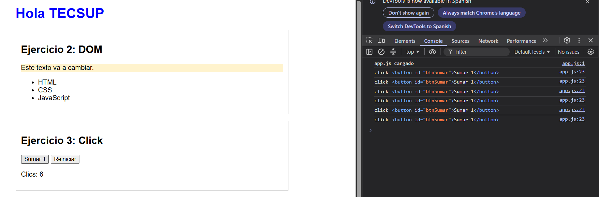
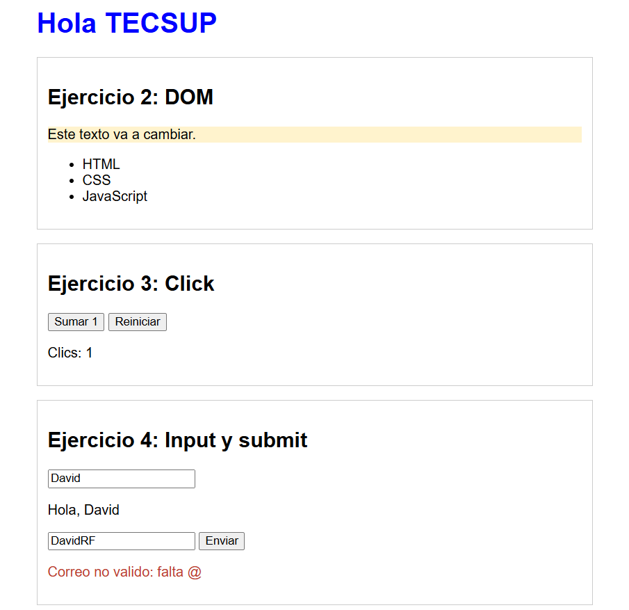
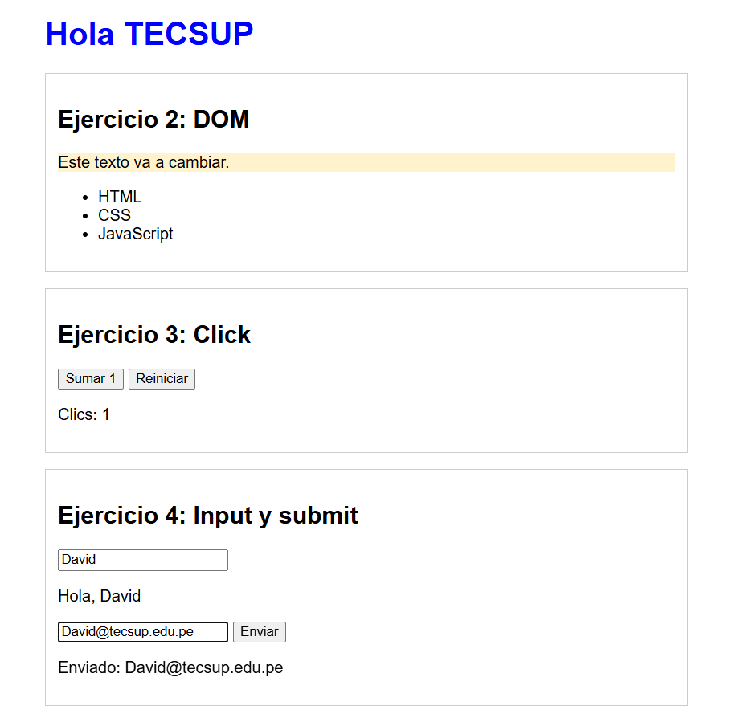
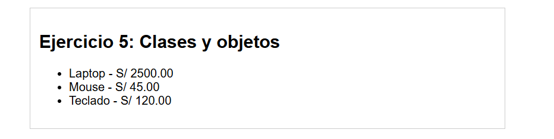
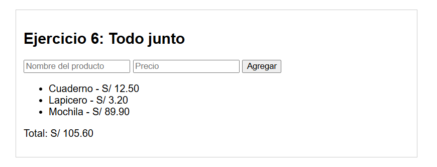

# Bitacora de JavaScript interactivo
Laboratorio 08: JavaScript Interactivo DOM, Eventos y Objetos.
Navegador usado: Google Chrome

## Preparación / Inicialización

## Ejercicio 2: Seleccionar y modificar el DOM

| Instruccion | Que cambio en la pantalla | Se mantiene al recargar (Si/No) |
|---|---|---|
| textContent desde la consola | Cambió el título temporalmente | No |
| textContent desde app.js | Cambió el título a Hola TECSUP | Sí |
| style.color | El título se puso azul | Sí |
| classList.add | El párrafo se puso amarillo (destacado) | Sí |
| createElement + appendChild | Se agregó JavaScript a la lista | Sí |

## Ejercicio 3: Evento click

| Tipo de evento | Que accion lo dispara | Cuanto suma por accion |
|---|---|---|
| click | Un clic con el mouse | 1 |
| dblclick | Doble clic rápido | 1 (si se configura) |
| mouseover | Pasar el mouse por encima | Depende de la lógica |

*Información de evento.type y evento.target:* `evento.type` muestra el nombre del tipo de evento ejecutado (como "click") y `evento.target` muestra el elemento HTML exacto que recibió la acción.

## Ejercicio 4: Eventos input y submit

| Prueba | Que paso en la pantalla | Se recargo la pagina (Si/No) |
|---|---|---|
| Escribir en el campo nombre | El saludo cambió letra por letra | No |
| Enviar sin preventDefault | Se recargó y desapareció | Sí |
| Enviar con preventDefault, correo sin @ | Salió el mensaje de error en rojo | No |
| Enviar con preventDefault, correo con @ | Salió el mensaje Enviado | No |

## Ejercicio 5: Clases y objetos

| Objeto | nombre | precio | descripcion() | conDescuento (0.25) |
|---|---|---|---|---|
| laptop | Laptop | 2500 | Laptop - S/ 2500.00 | 1875 |
| mouse | Mouse | 45 | Mouse - S/ 45.00 | 33.75 |
| teclado | Teclado | 120 | Teclado - S/ 120.00 | 90 |

*Ventaja de usar clases:* Permite crear múltiples instancias organizadas con los mismos atributos y métodos sin tener que escribir código repetido a mano en el HTML.

## Ejercicio 6: DOM, eventos y objetos juntos

| Prueba | Total que muestra la pagina | Correcto (Si/No) |
|---|---|---|
| Cuaderno 12.50 | 12.50 | Sí |
| + Lapicero 3.20 | 15.70 | Sí |
| + Mochila 89.90 | 105.60 | Sí |